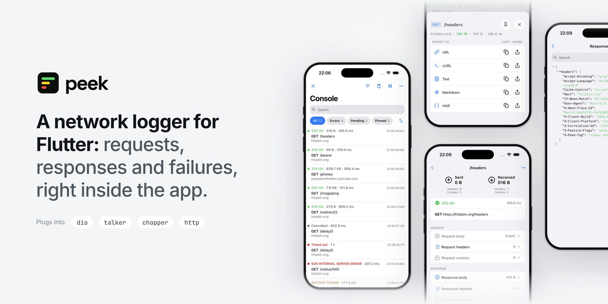

<p align="center">
  <picture>
    <source
      media="(prefers-color-scheme: dark)"
      srcset="assets/hero-dark.jpg">
    
  </picture>
</p>

<p align="center">
  <a href="https://pub.dev/packages/peek"></a>
  <a href="https://github.com/artdima/peek/actions/workflows/ci.yml"></a>
  <a href="https://codecov.io/gh/artdima/peek"></a>
  <a href="https://github.com/artdima/peek/blob/main/LICENSE"></a>
</p>

<p align="center">
  <a href="README.md">English</a> ·
  <a href="README.ru.md">Русский</a> ·
  <a href="README.zh-CN.md">简体中文</a> ·
  <b>Español</b> ·
  <a href="README.pt-BR.md">Português</a> ·
  <a href="README.ja.md">日本語</a>
</p>

**Qué es Peek.** Peek es un logger de red para Flutter que muestra las peticiones dentro de la propia app: peticiones, respuestas, cabeceras y errores. La búsqueda y los filtros te llevan a la llamada que buscas, y cualquier llamada se exporta como cURL, HAR, Markdown o texto.

Peek se conecta a Dio, Chopper y `package:http` mediante adaptadores. Si usas Talker, Peek toma los logs de red que ya registra, sin duplicarlos.

**Cómo funciona.** Peek observa las peticiones sin cambiar su contenido ni su comportamiento: no las retrasa, no las reintenta ni las reescribe. No crea ningún cliente, no usa `HttpOverrides` y no imprime nada en la consola: puedes seguir usando tu logger de consola de siempre.

`package:http` necesita un envoltorio, que deja pasar los datos sin cambios. Si algo falla dentro del propio Peek, el error va a `PeekOptions.onError` y la app sigue funcionando.

**Inspirado en Pulse.** La idea de Peek está inspirada en [Pulse](https://github.com/kean/Pulse), el logger de red para las plataformas de Apple. Peek es un proyecto independiente, escrito desde cero para Flutter.

<p align="center">
  
</p>
<p align="center">
  
</p>

## Inicio rápido

Con Dio, dos líneas donde se crea el cliente y una donde quieras un botón:

```dart
final dio = Dio(BaseOptions(baseUrl: 'https://api.example.com'));
dio.interceptors.add(PeekDioInterceptor(Peek.instance));

// Más tarde, desde cualquier widget:
showPeek(context);
```

Con Talker, una línea junto al Talker que ya tienes: las llamadas que ven sus loggers también las ve Peek:

```dart
final peek = Peek();
peek.attach(PeekTalkerAdapter(peek, talker: talker));
dio.interceptors.add(TalkerDioLogger(talker: talker));

showPeek(context, peek: peek);
```

Con Chopper, un interceptor en la cadena:

```dart
final client = ChopperClient(
  baseUrl: Uri.parse('https://api.example.com'),
  interceptors: [PeekChopperInterceptor(Peek.instance)],
);

showPeek(context);
```

Con `package:http`, que no tiene interceptores, un cliente que envuelve el tuyo:

```dart
final client = PeekHttpClient(Peek.instance, http.Client());

showPeek(context);
```

¿Prefieres un botón flotante siempre a mano? Envuelve la app una sola vez:

```dart
MaterialApp(
  builder: (context, child) => PeekOverlay(
    enabled: kDebugMode,
    child: child!,
  ),
);
```

Estas líneas se compilan, no son solo citas: viven en [`packages/peek/example`](packages/peek/example), una app que hace llamadas reales de las cuatro formas y recorre todas las pantallas.

## Paquetes

| Paquete | Qué es | Depende de |
| --- | --- | --- |
| [`peek`](packages/peek) | El modelo, el almacén y los exportadores (`package:peek/core.dart`, Dart puro) y la interfaz de Flutter (`package:peek/peek.dart`) | `flutter`, `meta` |
| [`peek_chopper`](packages/peek_chopper) | `PeekChopperInterceptor`: registra lo que hace un cliente de Chopper | `peek`, `chopper`, `http` |
| [`peek_dio`](packages/peek_dio) | `PeekDioInterceptor`: registra lo que hace un cliente de Dio | `peek`, `dio` |
| [`peek_http`](packages/peek_http) | `PeekHttpClient`: registra lo que hace un cliente de `package:http` | `peek`, `http` |
| [`peek_remote`](packages/peek_remote) | `PeekRemote`: envía las llamadas a Peek Pro en un Mac, en tiempo real | `peek`, `bonsoir`, `shared_preferences` |
| [`peek_talker`](packages/peek_talker) | `PeekTalkerAdapter`: lee lo que registra Talker; entiende `talker_dio_logger` de serie | `peek`, `peek_dio`, `talker`, `talker_dio_logger` |

## Configuración

Todo se configura una vez, en la instancia de `Peek`, y se aplica a todos los adaptadores:

```dart
final peek = Peek(
  options: PeekOptions(
    enabled: kDebugMode,
    limits: const PeekLimits(maxEntries: 500, maxBodyBytes: 256 * 1024),
    redaction: PeekRedactionPolicy(
      headerNames: {...PeekRedactionPolicy.defaultHeaderNames, 'x-session'},
    ),
    onError: (error, stackTrace) => log('peek: $error'),
  ),
);
```

- **`enabled`** — pasa `kDebugMode` para desactivar Peek en las builds de release sin tocar los adaptadores.
- **`limits`** — cuántas llamadas se guardan, cuántos bytes de un cuerpo y cuántas llamadas se pueden fijar. El límite de cuerpo se multiplica por `maxEntries`, así que ajusta uno teniendo en cuenta el otro.
- **`redaction`** — no se oculta nada hasta que lo pidas. `PeekRedactionPolicy()` cubre los nombres habituales (`Authorization`, `Cookie`, `token`, `password` y sus variantes); cada conjunto sustituye al predeterminado, así que para ampliarlo vuelve a incluir los valores por defecto con el operador spread.
- **Tema** — Peek trae su propio aspecto y de la app solo toma el brillo. Registra un override en el tema de la app para cambiar cualquier token: `ThemeData(extensions: [PeekTheme.light().copyWith(accent: Colors.teal)])`.
- **Textos** — hereda de `PeekStrings`, sobrescribe lo que traduzcas y pásalo a `showPeek(context, strings: ...)`.
- **Compartir** — Peek no depende de ningún paquete para compartir. Pásale un `PeekShareDelegate` conectado al que uses; el ejemplo lo muestra con `share_plus`. Lo que llega dice qué es: `PeekShareKind.text` es una URL, un comando cURL o un resumen para pegar, y `PeekShareKind.file`, un HAR o una sesión para adjuntar. En la web no hace falta nada: el navegador comparte el texto cuando puede y, si no, guarda el archivo; aun así, si pasas un delegado, se usa ese.

## Peek Pro

[Peek Pro](https://github.com/artdima/peek-pro) es una app para Mac con la que ver en tiempo real los logs de red de un teléfono, un simulador o un emulador. En la pantalla grande puedes buscar llamadas, seguir varias apps a la vez y guardar sesiones en archivos.

<p align="center">
  
</p>

Para conectarte, añade [`peek_remote`](packages/peek_remote) y arráncalo en las builds de depuración:

```dart
if (kDebugMode) {
  peek.attach(PeekRemote(peek)..start());
}
```

Después, elige Connect to Peek Pro en el menú de Peek e introduce el código que muestra la app del Mac. La conexión solo se configura una vez.

La guía completa está en [`doc/remote.md`](doc/remote.md): cómo configurar la conexión y qué datos se quedan en el dispositivo. Si estás creando tu propio visor de logs, el protocolo y el formato de archivo `.peek` están descritos en [`doc/spec/`](doc/spec/).

## Escribir tu propio adaptador

Un adaptador observa un logger y envía `PeekEvent`s a un `PeekSink`. Necesita un solo import —`package:peek/core.dart`— y más o menos una pantalla de código; [`doc/adapters.md`](doc/adapters.md) es la guía, desde el contrato hasta la estructura del paquete, con una lista de comprobación al final.

## Contribuir

Los errores y las ideas, mediante las plantillas de issues; los pull requests, según [`CONTRIBUTING.md`](CONTRIBUTING.md), que explica la configuración, los scripts y la definición de terminado. Los informes de seguridad son privados: consulta [`SECURITY.md`](SECURITY.md).

## Licencia

MIT © 2026 Dmitriy Medyannik. Los contornos de los iconos provienen de [Lucide](https://lucide.dev) (ISC); consulta [`NOTICE`](NOTICE).
