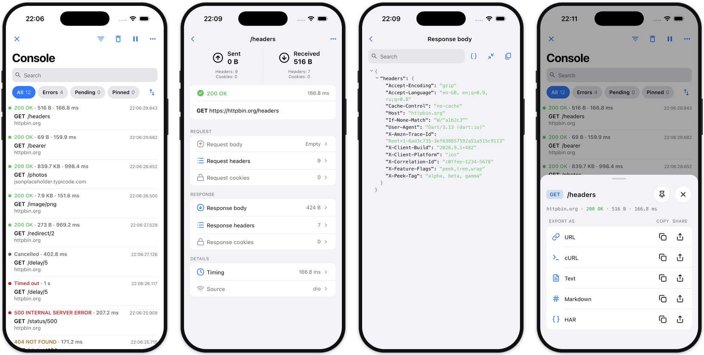
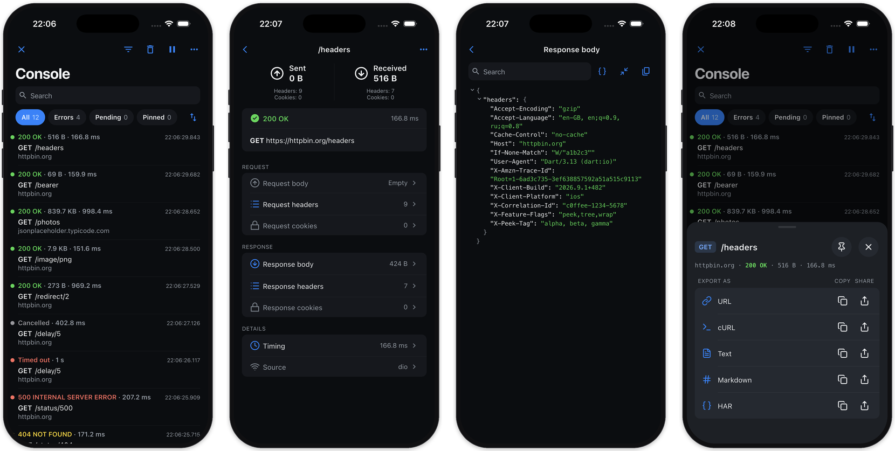
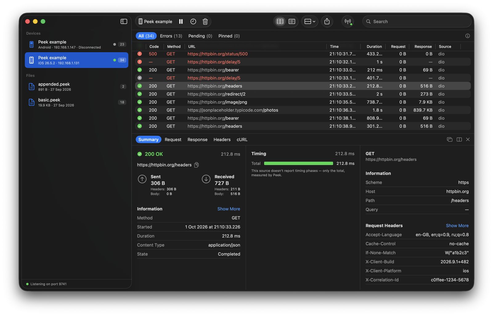

<p align="center">
  
  
</p>

<p align="center">
  <a href="https://pub.dev/packages/peek"></a>
  <a href="https://github.com/artdima/peek/actions/workflows/ci.yml"></a>
  <a href="https://codecov.io/gh/artdima/peek"></a>
  <a href="https://github.com/artdima/peek/blob/main/LICENSE"></a>
</p>

<p align="center">
  <a href="README.md">English</a> ·
  <a href="README.ru.md">Русский</a> ·
  <a href="README.zh-CN.md">简体中文</a> ·
  <a href="README.es.md">Español</a> ·
  <a href="README.pt-BR.md">Português</a> ·
  <b>日本語</b>
</p>

**Peek とは。** Peek は、通信をアプリ内でそのまま確認できる Flutter 向けのネットワークロガーです。リクエスト、レスポンス、ヘッダー、エラーを表示します。検索とフィルターで目的の通信をすばやく見つけ、cURL、HAR、Markdown、テキストとしてエクスポートできます。

Peek はアダプターを介して Dio、Chopper、`package:http` に接続します。Talker を使っている場合は、Talker がすでに記録しているネットワークログを重複させずに取り込みます。

**仕組み。** Peek はリクエストを観察するだけで、内容や挙動は変えません。遅延、再試行、書き換えは一切行いません。クライアントを作成せず、`HttpOverrides` も使わず、コンソールにも何も出力しません。使い慣れたコンソールロガーはそのまま使えます。

`package:http` にはラッパーが必要ですが、データは変更されずにそのまま渡されます。Peek 自体でエラーが起きた場合は `PeekOptions.onError` に渡され、アプリの動作は止まりません。

**Pulse に着想を得て。** Peek のアイデアは、Apple プラットフォーム向けのネットワークロガー [Pulse](https://github.com/kean/Pulse) に着想を得ています。Peek は Flutter のためにゼロから書かれた独立したプロジェクトです。

<p align="center">
  
</p>
<p align="center">
  
</p>

## クイックスタート

Dio の場合は、クライアントを作る場所に 2 行、ボタンを置きたい場所に 1 行追加します：

```dart
final dio = Dio(BaseOptions(baseUrl: 'https://api.example.com'));
dio.interceptors.add(PeekDioInterceptor(Peek.instance));

// あとで、任意のウィジェットから：
showPeek(context);
```

Talker の場合は、既存の Talker の隣に 1 行追加するだけです。Talker のロガーが見ている通信は Peek にも見えます：

```dart
final peek = Peek();
peek.attach(PeekTalkerAdapter(peek, talker: talker));
dio.interceptors.add(TalkerDioLogger(talker: talker));

showPeek(context, peek: peek);
```

Chopper の場合は、チェーンにインターセプターを 1 つ追加します：

```dart
final client = ChopperClient(
  baseUrl: Uri.parse('https://api.example.com'),
  interceptors: [PeekChopperInterceptor(Peek.instance)],
);

showPeek(context);
```

インターセプターのない `package:http` の場合は、既存のクライアントをもう 1 つのクライアントで包みます：

```dart
final client = PeekHttpClient(Peek.instance, http.Client());

showPeek(context);
```

常に表示されるフローティングボタンがほしい場合は、アプリを一度ラップします：

```dart
MaterialApp(
  builder: (context, child) => PeekOverlay(
    enabled: kDebugMode,
    child: child!,
  ),
);
```

これらのコードは単なる抜粋ではなく、実際にコンパイルされています。4 つの方法すべてで実際の通信を行い、すべての画面を動かすアプリ [`packages/peek/example`](packages/peek/example) に含まれています。

## パッケージ

| パッケージ | 内容 | 依存 |
| --- | --- | --- |
| [`peek`](packages/peek) | コアモデル、ストア、エクスポーター（`package:peek/core.dart`、純粋な Dart）と Flutter UI（`package:peek/peek.dart`） | `flutter`, `meta` |
| [`peek_chopper`](packages/peek_chopper) | `PeekChopperInterceptor`：Chopper クライアントの通信を記録 | `peek`, `chopper`, `http` |
| [`peek_dio`](packages/peek_dio) | `PeekDioInterceptor`：Dio クライアントの通信を記録 | `peek`, `dio` |
| [`peek_http`](packages/peek_http) | `PeekHttpClient`：`package:http` クライアントの通信を記録 | `peek`, `http` |
| [`peek_remote`](packages/peek_remote) | `PeekRemote`：通信を Mac 上の Peek Pro にリアルタイムで送信 | `peek`, `bonsoir`, `shared_preferences` |
| [`peek_talker`](packages/peek_talker) | `PeekTalkerAdapter`：Talker のログを読み取り、`talker_dio_logger` にそのまま対応 | `peek`, `peek_dio`, `talker`, `talker_dio_logger` |

## 設定

設定はすべて `Peek` インスタンスで一度だけ行い、すべてのアダプターに適用されます：

```dart
final peek = Peek(
  options: PeekOptions(
    enabled: kDebugMode,
    limits: const PeekLimits(maxEntries: 500, maxBodyBytes: 256 * 1024),
    redaction: PeekRedactionPolicy(
      headerNames: {...PeekRedactionPolicy.defaultHeaderNames, 'x-session'},
    ),
    onError: (error, stackTrace) => log('peek: $error'),
  ),
);
```

- **`enabled`** — `kDebugMode` を渡すと、アダプターに手を加えずにリリースビルドで Peek を無効にできます。
- **`limits`** — 保持する通信の数、ボディの最大バイト数、ピン留めできる通信の数。ボディの上限は `maxEntries` 件分かかるので、一方を上げるときはもう一方も考慮してください。
- **`redaction`** — 指定しない限り、何もマスクされません。`PeekRedactionPolicy()` は一般的な名前（`Authorization`、`Cookie`、`token`、`password` など）をカバーします。各セットは組み込みのセットを置き換えるので、拡張するときはスプレッド演算子でデフォルト値を加え直してください。
- **テーマ** — Peek は独自の外観を持ち、アプリからは明るさだけを受け取ります。任意のトークンを変更するには、アプリのテーマにオーバーライドを登録します：`ThemeData(extensions: [PeekTheme.light().copyWith(accent: Colors.teal)])`。
- **文言** — `PeekStrings` を継承して翻訳したい部分をオーバーライドし、`showPeek(context, strings: ...)` に渡します。
- **共有** — Peek は共有用のパッケージに依存しません。お使いの共有パッケージにつないだ `PeekShareDelegate` を渡してください。example では `share_plus` を使った例を示しています。渡される内容は自身の種類を示します：`PeekShareKind.text` は貼り付け用の URL、cURL コマンド、要約で、`PeekShareKind.file` は添付用の HAR やセッションです。Web では何も渡す必要はありません。ブラウザは可能ならテキストを共有し、そうでなければファイルとして保存します。それでもデリゲートを渡した場合は、そちらが使われます。

## Peek Pro

[Peek Pro](https://github.com/artdima/peek-pro) は、スマートフォン、シミュレーター、エミュレーターのネットワークログをリアルタイムで確認できる Mac アプリです。大きな画面で通信を検索し、複数のアプリを同時に追い、セッションをファイルに保存できます。

<p align="center">
  
</p>

接続するには、[`peek_remote`](packages/peek_remote) を追加し、デバッグビルドで起動します：

```dart
if (kDebugMode) {
  peek.attach(PeekRemote(peek)..start());
}
```

次に Peek のメニューで Connect to Peek Pro を選び、Mac アプリに表示されるコードを入力します。接続の設定は一度だけで済みます。

詳しい手順は [`doc/remote.md`](doc/remote.md) にあります。接続の設定方法と、どのデータがデバイスに残るかを説明しています。独自のログビューアーを作る場合は、プロトコルと `.peek` ファイル形式の仕様を [`doc/spec/`](doc/spec/) で確認できます。

## 独自のアダプターを書く

アダプターはロガーを監視し、`PeekEvent` を `PeekSink` に送ります。必要なのは `package:peek/core.dart` の import ひとつと、1 画面ほどのコードだけです。[`doc/adapters.md`](doc/adapters.md) が、契約からパッケージ構成までを扱うガイドで、最後にチェックリストがあります。

## コントリビュート

バグやアイデアは issue テンプレートから、プルリクエストは [`CONTRIBUTING.md`](CONTRIBUTING.md) に従ってお送りください。セットアップ、スクリプト、完了の定義が書かれています。セキュリティに関する報告は非公開でお願いします。[`SECURITY.md`](SECURITY.md) を参照してください。

## ライセンス

MIT © 2026 Dmitriy Medyannik。アイコンの輪郭は [Lucide](https://lucide.dev)（ISC）によるものです。[`NOTICE`](NOTICE) を参照してください。
