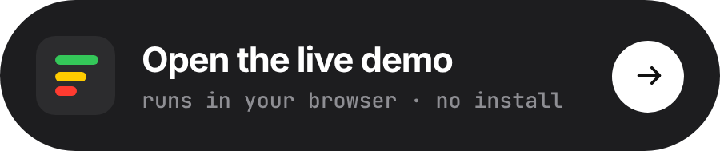

<p align="center">
  
  
</p>

<p align="center">
  <a href="https://pub.dev/packages/peek"></a>
  <a href="https://artdima.github.io/peek/"></a>
  <a href="https://github.com/artdima/peek/actions/workflows/ci.yml"></a>
  <a href="https://codecov.io/gh/artdima/peek"></a>
  <a href="https://github.com/artdima/peek/blob/main/LICENSE"></a>
</p>

<p align="center">
  <a href="README.md">English</a> ·
  <a href="README.ru.md">Русский</a> ·
  <a href="README.zh-CN.md">简体中文</a> ·
  <a href="README.es.md">Español</a> ·
  <b>Português</b> ·
  <a href="README.ja.md">日本語</a>
</p>

**O que é o Peek.** O Peek é um logger de rede para Flutter que mostra as requisições dentro do próprio app: requisições, respostas, cabeçalhos e erros. Com busca e filtros você encontra a chamada que procura, e qualquer chamada pode ser exportada como cURL, HAR, Markdown ou texto.

O Peek se conecta ao Dio, ao Chopper e ao `package:http` por meio de adaptadores. Se você usa o Talker, o Peek aproveita os logs de rede que ele já registra, sem duplicá-los.

<p align="center">
  <a href="https://artdima.github.io/peek/"></a>
</p>

**Como funciona.** O Peek observa as requisições sem alterar seu conteúdo nem seu comportamento: não as atrasa, não as repete e não as reescreve. Ele não cria cliente, não usa `HttpOverrides` e não imprime nada no console — você pode continuar usando o logger de console de sempre.

O `package:http` precisa de um wrapper, que repassa os dados sem alterações. Se algo der errado dentro do próprio Peek, o erro vai para `PeekOptions.onError` e o app continua funcionando.

**Inspirado no Pulse.** A ideia do Peek foi inspirada no [Pulse](https://github.com/kean/Pulse), o logger de rede para as plataformas da Apple. O Peek é um projeto independente, escrito do zero para Flutter.

<p align="center">
  
</p>
<p align="center">
  
</p>

## Início rápido

Com o Dio, duas linhas onde o cliente é criado e uma onde você quiser um botão:

```dart
final dio = Dio(BaseOptions(baseUrl: 'https://api.example.com'));
dio.interceptors.add(PeekDioInterceptor(Peek.instance));

// Depois, de qualquer widget:
showPeek(context);
```

Com o Talker, uma linha ao lado do Talker que você já tem — as chamadas que os loggers dele veem, o Peek também vê:

```dart
final peek = Peek();
peek.attach(PeekTalkerAdapter(peek, talker: talker));
dio.interceptors.add(TalkerDioLogger(talker: talker));

showPeek(context, peek: peek);
```

Com o Chopper, um interceptor na cadeia:

```dart
final client = ChopperClient(
  baseUrl: Uri.parse('https://api.example.com'),
  interceptors: [PeekChopperInterceptor(Peek.instance)],
);

showPeek(context);
```

Com o `package:http`, que não tem interceptores, um cliente envolvendo o seu:

```dart
final client = PeekHttpClient(Peek.instance, http.Client());

showPeek(context);
```

Prefere um botão flutuante sempre à mão? Envolva o app uma única vez:

```dart
MaterialApp(
  builder: (context, child) => PeekOverlay(
    enabled: kDebugMode,
    child: child!,
  ),
);
```

Estas linhas são compiladas, não apenas citadas: elas estão em [`packages/peek/example`](packages/peek/example), um app que faz chamadas reais das quatro formas e percorre todas as telas.

## Pacotes

| Pacote | O que é | Depende de |
| --- | --- | --- |
| [`peek`](packages/peek) | O modelo, o armazenamento e os exportadores (`package:peek/core.dart`, Dart puro) e a interface Flutter (`package:peek/peek.dart`) | `flutter`, `meta` |
| [`peek_chopper`](packages/peek_chopper) | `PeekChopperInterceptor`: registra o que um cliente Chopper faz | `peek`, `chopper`, `http` |
| [`peek_dio`](packages/peek_dio) | `PeekDioInterceptor`: registra o que um cliente Dio faz | `peek`, `dio` |
| [`peek_http`](packages/peek_http) | `PeekHttpClient`: registra o que um cliente `package:http` faz | `peek`, `http` |
| [`peek_remote`](packages/peek_remote) | `PeekRemote`: transmite as chamadas para o Peek Pro em um Mac, ao vivo | `peek`, `bonsoir`, `shared_preferences` |
| [`peek_talker`](packages/peek_talker) | `PeekTalkerAdapter`: lê o que o Talker registra; entende o `talker_dio_logger` de fábrica | `peek`, `peek_dio`, `talker`, `talker_dio_logger` |

## Configuração

Tudo é configurado uma vez, na instância de `Peek`, e vale para todos os adaptadores:

```dart
final peek = Peek(
  options: PeekOptions(
    enabled: kDebugMode,
    limits: const PeekLimits(maxEntries: 500, maxBodyBytes: 256 * 1024),
    redaction: PeekRedactionPolicy(
      headerNames: {...PeekRedactionPolicy.defaultHeaderNames, 'x-session'},
    ),
    onError: (error, stackTrace) => log('peek: $error'),
  ),
);
```

- **`enabled`** — passe `kDebugMode` para desligar o Peek nas builds de release sem mexer nos adaptadores.
- **`limits`** — quantas chamadas são guardadas, quantos bytes de um corpo e quantas chamadas podem ser fixadas. O limite de corpo é multiplicado por `maxEntries`, então ajuste um pensando no outro.
- **`redaction`** — nada é mascarado até você pedir. `PeekRedactionPolicy()` cobre os nomes usuais (`Authorization`, `Cookie`, `token`, `password` e variações); cada conjunto substitui o padrão, então, para ampliá-lo, inclua os valores padrão de volta com o operador spread.
- **Tema** — o Peek traz o próprio visual e do app só pega o brilho. Registre um override no tema do app para mudar qualquer token: `ThemeData(extensions: [PeekTheme.light().copyWith(accent: Colors.teal)])`.
- **Textos** — estenda `PeekStrings`, sobrescreva o que for traduzir e passe para `showPeek(context, strings: ...)`.
- **Compartilhamento** — o Peek não depende de nenhum pacote de compartilhamento. Passe a ele um `PeekShareDelegate` ligado ao pacote que você usa; o exemplo mostra isso com o `share_plus`. O que chega diz o que é: `PeekShareKind.text` é uma URL, um comando cURL ou um resumo para colar, e `PeekShareKind.file` é um HAR ou uma sessão para anexar. Na web não é preciso passar nada: o navegador compartilha o texto quando pode e, caso contrário, salva o arquivo; ainda assim, se você passar um delegate, ele é usado no lugar.

## Peek Pro

O [Peek Pro](https://github.com/artdima/peek-pro) é um app para Mac para acompanhar em tempo real os logs de rede de um celular, simulador ou emulador. Na tela grande você pode buscar chamadas, acompanhar vários apps ao mesmo tempo e salvar sessões em arquivos.

<p align="center">
  
</p>

Para conectar, adicione o [`peek_remote`](packages/peek_remote) e inicie-o nas builds de debug:

```dart
if (kDebugMode) {
  peek.attach(PeekRemote(peek)..start());
}
```

Depois, escolha Connect to Peek Pro no menu do Peek e digite o código exibido no app do Mac. A conexão só precisa ser configurada uma vez.

O guia completo está em [`doc/remote.md`](doc/remote.md): como configurar a conexão e quais dados ficam no dispositivo. Se você está criando seu próprio visualizador de logs, o protocolo e o formato de arquivo `.peek` estão descritos em [`doc/spec/`](doc/spec/).

## Escrevendo seu próprio adaptador

Um adaptador observa um logger e envia `PeekEvent`s para um `PeekSink`. Ele precisa de um único import — `package:peek/core.dart` — e de mais ou menos uma tela de código; [`doc/adapters.md`](doc/adapters.md) é o guia, do contrato à estrutura do pacote, com um checklist no final.

## Contribuindo

Bugs e ideias vão pelos templates de issue; pull requests, conforme o [`CONTRIBUTING.md`](CONTRIBUTING.md), que traz a configuração, os scripts e a definição de pronto. Relatos de segurança são privados: veja [`SECURITY.md`](SECURITY.md).

## Licença

MIT © 2026 Dmitriy Medyannik. Os contornos dos ícones vêm do [Lucide](https://lucide.dev) (ISC); veja [`NOTICE`](NOTICE).
